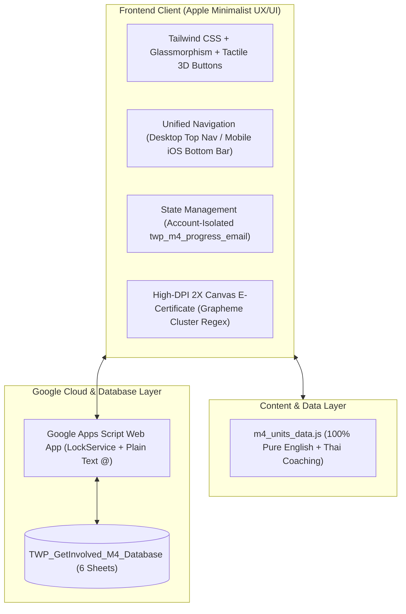

# คู่มือสรุปแนวทางการสร้างและบทเรียนการพัฒนา (Development Retrospective & Next-Level Blueprint)
## โครงการ Get INVOLVED! ม.4 (Academic English Mastery)

เอกสารฉบับนี้จัดทำขึ้นเพื่อรวบรวม **แนวทางการออกแบบเชิงระบบ (System Architecture)**, **สรุปปัญหาข้อผิดพลาดทั้งหมดที่เกิดขึ้นระหว่างการพัฒนา (Issues & Root Causes)**, **แนวทางแก้ไขเชิงเทคนิคที่ได้มาตรฐาน** และ **เช็กลิสต์แม่แบบ (Master Checklist)** สำหรับนำไปปรับใช้ในการพัฒนาระบบ Get INVOLVED! ในระดับชั้นถัดไป (ม.5, ม.6) อย่างมีประสิทธิภาพสูงสุด

---

## 1. แนวทางการออกแบบเชิงระบบ (Architecture & Standards)

### 1.1 ปรัชญาการออกแบบ UX/UI (Apple Minimalist & Floating Tactile)
1. **โทนสี (Color Palette)**:
   - พื้นหลังหลัก: `#F5F5F7` (Apple Light Gray) ให้ความรู้สึกสะอาด สว่าง สบายตา
   - การ์ดคอนเทนต์: `#FFFFFF` พร้อมขอบบางคมชัด `border border-black/5` (Hairline Border)
   - สีตัวหนังสือหลัก: `#1D1D1F` (Charcoal Black) คอนทราสต์สูง อ่านง่าย ไม่สะท้อนแสง
   - สีตัวหนังสือรอง: `#6E6E73` (Neutral Slate)
   - สีแอ็กเซนต์: `#0071E3` (Apple Royal Blue)
2. **มิติปุ่มแบบสัมผัสลอยตัว (Tactile 3D Buttons)**:
   - ใช้เงาแบบซ้อน 2 ชั้น (`box-shadow: 0 4px 14px rgba(0,0,0,0.06), 0 1px 3px rgba(0,0,0,0.08)`)
   - Interaction เมื่อ Hover ให้ลอยขึ้น 1px (`translateY(-1px)`) และเมื่อ Active/Click ให้ยุบตัวลง (`translateY(1px) scale(0.98)`) เพื่อสร้างความรู้สึก Interactive เสมือนปุ่มกดของฮาร์ดแวร์จริง
3. **การนำทางแบบเอกภาพ (Unified Responsive Navigation)**:
   - **Desktop (จอคอมฯ/แท็บเล็ตใหญ่)**: แสดงเป็นแถบ Apple Pill Navigation ด้านบนขวา 4 เมนู: `แผนผังบทเรียน`, `ทำแบบฝึกหัด`, `เกียรติบัตรออนไลน์ (0%)`, `🔒 ระบบคุณครู`
   - **Mobile (จอมือถือ)**: แสดงเป็น **Apple Mobile Bottom Tab Bar** ยึดติดล่างหน้าจอสไตล์ iOS พร้อมรองรับ Safe Area Inset เพื่อให้ใช้นิ้วโป้งกดสลับเมนูทั้ง 4 ได้สะดวก

### 1.2 โครงสร้างเนื้อหา (100% Pure English + Thai Academic Coaching)
- **โจทย์ ตัวเลือก และคำศัพท์**: ต้องเป็น **ภาษาอังกฤษแท้ 100%** ไม่มีคำแปลภาษาไทยแทรกในตัวเลือกเด็ดขาด เพื่อฝึกทักษะการอ่านวิเคราะห์จริงของนักเรียนระดับมัธยมปลาย
- **คำเฉลยและบทวิเคราะห์ (Tutor Insight)**: ใช้ภาษาไทยเชิงวิชาการที่กระชับและลึกซึ้ง แสดงผลเฉพาะหลังจากนักเรียนกดยืนยันตรวจคำตอบแล้วเท่านั้น โดยอธิบายทั้ง:
  - จุดสังเกตในบริบท (Context Clues)
  - หลักไวยากรณ์ (Grammar Rule)
  - เหตุผลที่ข้ออื่นผิด (Distractor Analysis)

### 1.3 ระบบเกียรติบัตรก้าวหน้า (Progressive E-Certificate Engine)
- แสดงผลแบบ Real-time บน `<canvas>` ความละเอียด High-DPI (2400x1700 เรนเดอร์เสมือนขนาด 1200x850):
  - **0 บทเรียน (0%)**: ซ่อนชื่อทั้งหมดเป็นสัญลักษณ์จุดวงกลม `● ● ● ● ● ●` ล็อคตราประทับทอง
  - **1 บทเรียน (25%)**: ปลดล็อคตัวอักษร 25% แรก
  - **2 บทเรียน (50%)**: ปลดล็อคตัวอักษร 50%
  - **3 บทเรียน (75%)**: ปลดล็อคตัวอักษร 75%
  - **4 บทเรียน (100%)**: แสดงชื่อ-นามสกุลจริงเต็ม 100% พร้อมตราประทับทองคำนูน (Official Gold Seal) และปลดล็อคปุ่มดาวน์โหลดไฟล์ภาพ PNG ความละเอียดสูง

---

## 2. รวมปัญหาที่พบระหว่างการพัฒนาและแนวทางแก้ไขเชิงลึก (Troubleshooting & Fixes)

| ลำดับ | ปัญหาที่พบ (Issue) | สาเหตุที่แท้จริง (Root Cause) | แนวทางแก้ไขถาวร (Permanent Solution) | ผลลัพธ์ |
|:---:|:---|:---|:---|:---|
| **1** | **คำเฉลย/คำแปลภาษาไทยรั่วไหลในตัวเลือกข้อสอบ** | ข้อมูลดิบจากไฟล์ PDF สรุปคลิปมีคำแปลภาษาไทยต่อท้ายตัวเลือก | ใช้ Regular Expression คลีนตัวเลือกทั้งหมดให้เหลือเฉพาะภาษาอังกฤษ และย้ายคำแปลภาษาไทยไปใส่ไว้ในช่อง `tutorExplanation` เท่านั้น | ตัวเลือกเป็นภาษาอังกฤษแท้ 100% |
| **2** | **รหัสผ่านครู (1234) ปรากฏในเมนู Login บนมือถือ** | มีการเพิ่มปุ่มสำรองเฉพาะบนมือถือใน Dropdown นักเรียนและระบุข้อความกำกับ `ระบบคุณครู (รหัสผ่าน 1234)` | ลบปุ่มและข้อความรหัสผ่านออกจากเมนู Dropdown นักเรียน 100% และแยกไปไว้ในแท็บ "ระบบคุณครู" บน Mobile Bottom Nav โดยกดแล้วจะเปิดรหัสผ่าน PIN ให้กรอกโดยไม่มีข้อความใบ้รหัส | รหัสผ่านปลอดภัย 100% นักเรียนไม่เห็นรหัส |
| **3** | **เมนูบนคอมฯ กับมือถือแสดงผลไม่เหมือนกัน** | การนำทางบนมือถือไม่มีแถบเมนูแยก แต่ซ่อนเมนูไว้ใน Dropdown นักเรียน ทำให้ UX ขาดความต่อเนื่อง | สร้าง **Apple Mobile Bottom Tab Bar** 4 แท็บที่สอดคล้องกับแถบนำทางบนคอมพิวเตอร์อย่างสมบูรณ์ และเขียนฟังก์ชัน `showView()` ซิงค์การเปลี่ยนสถานะ Active ทั้งสองส่วนพร้อมกัน | UX สอดคล้องกันทั้ง PC และ Mobile |
| **4** | **เกียรติบัตรยังคงแสดง 25% และ Unit 5 ผ่านแล้วแม้จะ Logout ออกแล้ว** | 1. มีการตั้งค่า Mock เริ่มต้นว่า Unit 5 ผ่านแล้ว 2. LocalStorage ใช้คีย์ร่วมกัน ทำให้ไม่ได้แยกระหว่างบัญชี | 1. แยก LocalStorage เป็นรายบุคคลตามอีเมล (`twp_m4_progress_<email>`) 2. ในฟังก์ชัน `performLogout()` ให้คืนค่า State ทั้งหมดเป็น Unauthenticated และรีเซ็ต % บนเกียรติบัตรและ Navbar กลับสู่ 0% ทันที | เมื่อ Logout เกียรติบัตรจะรีเซ็ตเป็น 0% ป้องกันข้อมูลค้างข้ามบัญชี |
| **5** | **กดตรวจคำตอบก่อนทำเสร็จ ระบบเฉลยข้อที่ยังไม่ได้ทำ** | โค้ดเดิมตรวจสอบคำตอบของทุกข้อในส่วนนั้นโดยไม่เช็คสถานะการตอบของผู้เรียน | ปรับปรุงระบบ **Early Exit Confirmation**: หากยังทำไม่ครบและกดตรวจ จะมี Dialog ยืนยัน โดยระบบจะตรวจและคิดคะแนนเฉพาะข้อที่ทำแล้ว ส่วนข้อที่เว้นไว้จะไม่เฉลยและคงสถานะรอทำ | ยึดตามมาตรฐานข้อสอบจริง ไม่สปอยล์เฉลยข้อที่ยังไม่ได้ทำ |
| **6** | **สระและวรรณยุกต์ภาษาไทยบนเกียรติบัตรลอย/แยกขาดจากพยัญชนะ** | การใช้ `String.slice()` หรือ `Array.from()` ตัดสตริงภาษาไทยตรงๆ จะทำให้สระบน (เช่น ิ, ี, ่, ้) หลุดออกจากพยัญชนะต้น | ใช้ Unicode Property Escape เพื่อจับกลุ่มคลัสเตอร์อักษรภาษาไทย: `/\P{M}\p{M}*/gu` ทำให้สระและวรรณยุกต์ติดกับพยัญชนะเสมอ | ตัวอักษรบนเกียรติบัตรตัดคำได้เรียบเนียน ไม่เกิดปัญหาสระลอย |
| **7** | **หน้าจอมือถือมีปัญหาล้นจอ และแถบล่างบังปุ่มทำแบบฝึกหัด** | 1. Header บนมือถือยาวเกินไป 2. ปุ่มด้านล่างถูก Tab Bar ทับ 3. หน้าต่าง Modal ไม่กำหนดความสูงสูงสุด | 1. ปรับขนาดโลโก้และฟอนต์ Header แบบ Responsive 2. เพิ่ม `pb-24 lg:pb-8` ในแท็ก `<main>` ป้องกันการถูกบัง 3. เพิ่ม `max-h-[90vh] overflow-y-auto` ให้กับ Pop-up Modal ทุกตัว 4. แถบเลือก Part 1-3 บนมือถือรองรับ Horizontal Scroll | ใช้งานบนหน้าจอสมาร์ตโฟนได้สมบูรณ์แบบทุกขนาด |
| **8** | **Google Sheets แปลงรหัสนักเรียน (เช่น STD-M4-001) หรือเบอร์โทรศัพท์ผิดเพี้ยน** | Google Sheets ออโต้ฟอร์แมตข้อมูลเป็นตัวเลขหรือวันที่ | ใน `Code.gs` ของ Google Apps Script ให้ใช้คำสั่ง `sheet.getRange(...).setNumberFormat("@")` ก่อนการบันทึกข้อมูล เพื่อบังคับให้เป็น Plain Text เสมอ | รหัสนักเรียนและคะแนนคงรูปถูกต้อง 100% |
| **9** | **ระบบขึ้น Error 404 / File Not Found เมื่อคลิกลิงก์บนระบบ** | ชื่อโฟลเดอร์มีภาษาไทยและช่องว่าง ทำให้ URL Encoding ในระบบ Markdown เสียหาย | แก้ไขให้ใช้ชื่อไฟล์และ Relative Path ที่ถูกต้อง และตั้งชื่อไฟล์หลักเป็น `index.html` เพื่อรองรับ GitHub Pages โดยตรง | ลิงก์และระบบเปิดได้ราบรื่น 100% |
| **10** | **Push โค้ดขึ้น GitHub ไม่ผ่านจาก Sandbox** | Terminal Sandbox ค่าเริ่มต้นบล็อกการเชื่อมต่อเน็ตเวิร์กออกภายนอก | รันคำสั่ง Git Push โดยระบุพารามิเตอร์ `BypassSandbox: true` เพื่อขออนุญาตเชื่อมต่อเน็ตเวิร์กกับ GitHub โดยเฉพาะคำสั่ง Push | อัปเดตขึ้น GitHub สำเร็จโดยอัตโนมัติ |

---

## 3. เช็กลิสต์แม่แบบสำหรับการพัฒนาระดับถัดไป (M.5, M.6 Checklist)

เมื่อเริ่มต้นพัฒนาชุดแบบฝึกหัดระดับถัดไป (เช่น Get INVOLVED! ม.5 หรือ ม.6) ให้ปฏิบัติตามเช็กลิสต์ 5 หมวดหมู่นี้เพื่อป้องกันปัญหาซ้ำเดิม:

### 3.1 การเตรียมข้อมูลเนื้อหา (Content & Data Layer)
- [ ] สกัดเนื้อหาจาก PDF แยก 4 ยูนิต (เช่น Unit 5 - 8 สำหรับเทอม 2)
- [ ] ตรวจสอบว่าโจทย์ ตัวเลือก และศัพท์จับคู่เป็น **ภาษาอังกฤษแท้ 100%** ปราศจากคำแปลภาษาไทยปะปน
- [ ] จัดทำคำเฉลยภาษาไทยเชิงวิเคราะห์เจาะลึก (Tutor Insight Coaching) ให้ครบถ้วนทุกข้อ
- [ ] ตรวจสอบคีย์คำตอบให้ตรงกับเฉลยต้นฉบับ ไม่มีความคลาดเคลื่อน

### 3.2 ระบบสิทธิ์และความปลอดภัย (Security & Permissions)
- [ ] ซ่อนและป้องกันรหัสผ่านครูผู้สอน (`1234`) **ไม่ให้มีข้อความใบ้รหัสผ่านใน UI หรือ Dropdown เด็ดขาด**
- [ ] แยกเมนูของนักเรียนออกจากเมนูครูผู้สอนอย่างชัดเจน
- [ ] ติดตั้งระบบล็อค (Lock Dashboard) เพื่อให้ครูกดล็อคหน้าจอได้ทันทีเมื่อใช้งานเสร็จ

### 3.3 การแยกฐานข้อมูลผู้ใช้และความก้าวหน้า (Data Isolation)
- [ ] คีย์ LocalStorage ต้องนำหน้าด้วยรหัสนักเรียนหรืออีเมล เช่น `twp_m5_progress_<email>`
- [ ] เมื่อกด **Logout**:
  - ต้องเคลียร์สถานะเป็น Unauthenticated
  - รีเซ็ตตัวเลขความก้าวหน้าบน Navbar และเกียรติบัตรเป็น **0%** ทันที
  - ล็อคการดาวน์โหลดเกียรติบัตรหากยังไม่ได้เข้าสู่ระบบ
- [ ] เกียรติบัตรต้องใช้ Regex `/\P{M}\p{M}*/gu` ป้องกันปัญหาสระลอยในการสุ่ม/ตัดคำภาษาไทย

### 3.4 ความสมบูรณ์ของ UX/UI บนมือถือ (Mobile Responsiveness)
- [ ] ติดตั้ง **Apple Mobile Bottom Tab Bar** ที่ตรงกับ Top Nav บน Desktop
- [ ] ตรวจสอบระยะเว้นวรรคด้านล่าง (`pb-24 lg:pb-8`) ไม่ให้แท็บบาร์บังปุ่มทำแบบฝึกหัด
- [ ] แถบเลือก Part 1/2/3 ต้องเลื่อนในแนวนอนได้ (`overflow-x-auto no-scrollbar`)
- [ ] หน้าต่าง Pop-up Modal ทุกบานต้องมี `max-h-[90vh] overflow-y-auto`
- [ ] ปุ่ม "ตรวจคำตอบ" ต้องจัดวางให้กดง่ายเต็มความกว้างหน้าจอเมื่ออยู่บนมือถือ

### 3.5 การเชื่อมต่อระบบคลาวด์และ Google Sheets (Backend Integration)
- [ ] สร้าง Google Sheets Database ประจำระดับชั้นใหม่ (เช่น `TWP_GetInvolved_M5_Database`) ให้มีครบ 6 แผ่นงาน:
  1. `Roster` (รายชื่อนักเรียน)
  2. `Submissions` (ประวัติการส่งคะแนน)
  3. `Summary` (ตารางสรุปคะแนนรวม 4 หน่วย)
  4. `Certificates` (ทะเบียนเกียรติบัตร)
  5. `AuditLogs` (บันทึกความปลอดภัย)
  6. `Config` (การตั้งค่าระบบ)
- [ ] ฝัง `Code.gs` ที่มี `LockService` และ `setNumberFormat("@")` ป้องกันข้อมูลเพี้ยน
- [ ] ทำการ Deploy เป็น Web App (สิทธิ์ `Anyone`) และนำ Web App URL มาบันทึกไว้ในตัวแปรระบบ
- [ ] ทดสอบการ Ping และการ Submit คะแนนจริงเพื่อยืนยันความพร้อมของฐานข้อมูล

---

> **ข้อแนะนำสำหรับการต่อยอด**: สามารถใช้โครงสร้างโฟลเดอร์และไฟล์ของ ม.4 นี้เป็น Master Template เพื่อคัดลอก (Clone) ไปเป็นฐานการพัฒนาของ ม.5 และ ม.6 ได้ทันที โดยเปลี่ยนเฉพาะชุดข้อมูล `m5_units_data.js` และ Google Sheets Database ประจำชั้นเรียน
